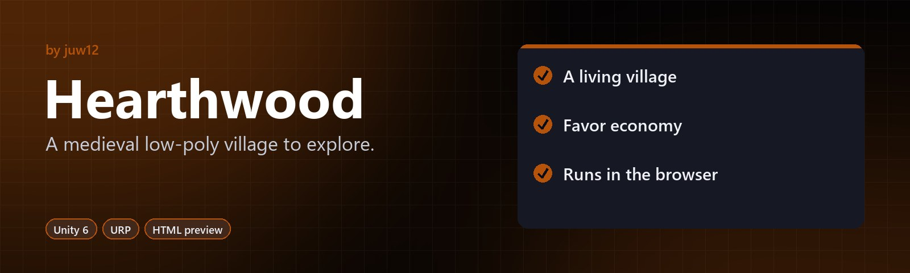

<!-- HERO:START -->
<p align="center">
  <a href="https://github.com/juw12/hearthwood"></a>
</p>

<p align="center">
  <b>A medieval low-poly village to explore.</b><br>
  A third-person action-adventure prototype with dialogue, quests, inventory and NPC AI.
</p>

<p align="center">
  <a href="#highlights">Highlights</a> ·
  <a href="https://github.com/juw12">More by juw12</a>
</p>

<p align="center">
  <a href="https://github.com/juw12/hearthwood"></a>
  
  
  
</p>

<a id="highlights"></a>
<table>
  <tr>
    <td width="33%" valign="top">
      <b>A living village</b><br>
      NPCs with daily routines, dialogue and quests.
    </td>
    <td width="33%" valign="top">
      <b>Favor economy</b><br>
      A favor-token economy and an inventory.
    </td>
    <td width="33%" valign="top">
      <b>Runs in the browser</b><br>
      A self-contained HTML preview, built on Unity 6 + URP.
    </td>
  </tr>
</table>
<!-- HERO:END -->

## About

A medieval low-poly village prototype built on **Unity 6** + **URP** + **Input System**,
shipping as cross-platform PC + WebGL with a self-contained HTML preview that runs without
the engine.

> **Start here:** open [`preview.html`](./preview.html) by double-click. No engine install
> required. The full 3D prototype requires Unity 6 LTS — see [`SETUP.md`](./SETUP.md).

---

## What This Is

A **full prototype** (not a vertical slice) of an action-adventure village game with:

- **3rd-person character controller** with sprint, jump, dodge, attack
- **Combat** (sword) against NPCs/wolves
- **Inventory** (20 slots, stackable, shop-ready)
- **Dialogue system** (branches, quest-gated choices, {playerName} substitution)
- **Quest system** (prerequisite chains, multi-objective, rewards via Favor Tokens)
- **Collectibles** (herbs, wood, coins — with optional quest linking)
- **NPC AI** (idle / wander via NavMesh / talking state)
- **Save / load** (PlayerPrefs JSON, WebGL-safe via IndexedDB)
- **Audio** (SFX pool, music crossfade, ambient layers, footsteps tied to IsGrounded/IsSprinting)

The unique progression element is **Favor Tokens** — earned by completing villager quests and
dialogue branches, spent at the shop for discounts or to unlock new quest lines.

---

## Controls

| Action | Key (PC/WebGL) |
|---|---|
| Move | `W A S D` / Arrow keys |
| Look (camera) | Mouse |
| Jump | `Space` |
| Sprint | `Left Shift` |
| Interact (talk / collect / fight) | `E` |
| Attack (sword swing) | `Left Mouse` |
| Dodge | `Left Ctrl` |
| Inventory | `I` |
| Quest log | `Tab` |
| Pause | `Esc` |
| Dialogue advance | `Space` / `E` |
| Dialogue choice 1–4 | `1` `2` `3` `4` |

Action maps switch automatically: Player → UI when modals open, Player → Dialogue when
talking to an NPC. Driven by `InputManager` listening to `GameManager.OnStateChanged`.

---

## Repository Layout

```
Games/Hearthwood/
├── preview.html              ← opens in any browser, no engine needed
├── README.md                 ← this file
├── SETUP.md                  ← engine editor walkthrough
├── ARCHITECTURE.md           ← binding contract (read before modifying code)
├── ASSETS.md                 ← asset pack list + licensing notes
├── Packages/
│   └── manifest.json         ← Unity package manifest (URP, Input System, Cinemachine, etc.)
└── Assets/
    ├── Scripts/
    │   ├── Core/             ← Hearthwood.Core — interfaces, singletons, ScriptableObject schemas
    │   ├── Input/            ← Hearthwood.Input — InputManager
    │   ├── Audio/            ← Hearthwood.Audio — AudioManager, AmbientAudioManager, FootstepPlayer, InteractionAudio
    │   ├── Scene/            ← Hearthwood.Scene — SceneController
    │   ├── Player/           ← Hearthwood.Player — PlayerController3D, CombatController, HealthComponent, InventoryComponent, PlayerCamera, PlayerPersistence
    │   ├── Quest/            ← Hearthwood.Quest — QuestSystem, ItemDatabase, QuestGiver
    │   ├── Dialogue/         ← Hearthwood.Dialogue — DialogueRunner, DialogueTrigger
    │   ├── Collectible/      ← Hearthwood.Collectible — Collectible, CollectibleSpawner
    │   ├── NPC/              ← Hearthwood.NPC — NPCController, NPCSpawner
    │   ├── UI/               ← Hearthwood.UI — HUDController, DialogueUI, QuestLogUI, PauseMenuUI, InventoryUI, UIInputBinder, InteractPromptUI
    │   └── Editor/           ← Hearthwood.EditorTools — custom inspectors + sample content bootstrap (Editor-only)
    ├── ScriptableObjects/    ← generated SO assets (run "Hearthwood/Generate Sample Content")
    ├── Scenes/               ← your Village scene goes here
    ├── Settings/             ← HearthwoodInputActions.inputactions
    └── Resources/            ← fonts, audio banks, runtime-loaded assets
```

Each subsystem has its own `.asmdef` (assembly definition) so compile errors surface
clearly and dependencies stay one-directional.

---

## Quick Start (engine)

1. Open Unity 6 LTS, point it at `Games/Hearthwood/`.
2. Wait for package import (`Packages/manifest.json`).
3. Menu: **Hearthwood ▸ Generate Sample Content** — creates the medieval-village dataset
   (items, collectibles, NPCs, quests, dialogues, scene data).
4. Follow [`SETUP.md`](./SETUP.md) to wire a scene, drop in a player + 2 NPCs + 5 herbs,
   and press Play.

## Quick Start (preview only)

1. Double-click `preview.html`.
2. Click **Begin Adventure**.
3. WASD to move, E to interact.

The HTML preview demonstrates ALL gameplay systems without Unity: dialogue trees, quest
progression, inventory, save/load, combat (via wolves), favor rewards, full quest flow
ending in Iron Sword reward. State persists to `localStorage` across reloads.

---

## Honest Limitations

- **Cannot compile here.** This sandbox has no Unity Editor, so the C# files were authored
  to match Unity 6 / URP / Input System conventions but have not been compiled in-engine.
  See [`SETUP.md`](./SETUP.md) for the editor-side validation steps.
- **No real 3D / 2D assets shipped.** Characters, buildings, audio clips must come from
  the packs listed in [`ASSETS.md`](./ASSETS.md). Primitive cube placeholders are
  generated at runtime by `CollectibleSpawner` and `NPCSpawner` so the prototype runs
  even with zero imported assets.
- **No baked lighting / NavMesh / shader graphs.** Lighting, navigation, and shaders are
  authored in-editor — see `SETUP.md`.
- **QuestSystem does not expose per-objective current count publicly.** The HUD and
  QuestLog UI track objective progress locally via events (`OnItemCollected` /
  `OnObjectiveCompleted`) and show that mirror. The source of truth is still
  `QuestSystem._objectiveProgress`; the UI mirror can lag by one frame but converges
  immediately after each event. A future revision could add
  `QuestSystem.GetObjectiveProgress(questId, objectiveId)` if exact server-authoritative
  reads become necessary.

---

## What's Where (quick reference)

| Need to change… | Look at… |
|---|---|
| A quest's objectives | `QuestData` SO asset → custom inspector under **Hearthwood/Quests** |
| An NPC's dialogue | `DialogueData` SO asset → **Hearthwood/Dialogues** custom inspector |
| Movement speed / jump height | `PlayerController3D.cs` → serialized fields |
| Sword damage / range | `CombatController.cs` → `Damage`, `Range`, `AttackDurationSeconds` |
| Inventory capacity | `InventoryComponent.cs` → `Capacity` |
| Key bindings | `Assets/Settings/HearthwoodInputActions.inputactions` |
| Add a new event flow | `ARCHITECTURE.md` §4 (public API contract) and §8 (event flow) |

---

## Sample Quest Flow (the demo scenario)

1. **Begin Adventure** → quest **"Gather Wild Herbs"** auto-starts (5× Herb from
   south-east patch).
2. Walk to the herb patch, press `E` on each herb → objective counter ticks up.
3. At 5/5, **"Quest Complete! +5 Favor Tokens"** → quest **"Deliver a Message"** auto-starts
   (talk to Mara the Innkeeper).
4. Walk to Mara, press `E` → dialogue opens → pick **"I'll deliver it"** → quest
   completes → +3 Favor Tokens → quest **"The Bandit Problem"** auto-starts (defeat 3 wolves).
5. Each wolf without the Iron Sword deals -15 HP; with it, no damage. HP system is reactive
   via `HealthComponent.OnChanged`.
6. At 3/3, the Iron Sword is added to your inventory. Rest at the tavern.

---

## Next Steps Beyond This Prototype

- Bake NavMesh into the village
- Author a Cinemachine 3rd-person camera rig (replace `PlayerCamera`)
- Add shop UI that spends Favor Tokens
- Hook `GrantItem` delegate in `QuestSystem` to actually push rewards into inventory
- Author real ambient/SFX banks (current `InteractionAudio` clips are placeholder
  AudioClip null-references — inspector-assign when you have assets)

See [`ASSETS.md`](./ASSETS.md) for the asset pipeline and [`SETUP.md`](./SETUP.md) for the
editor-side setup.
